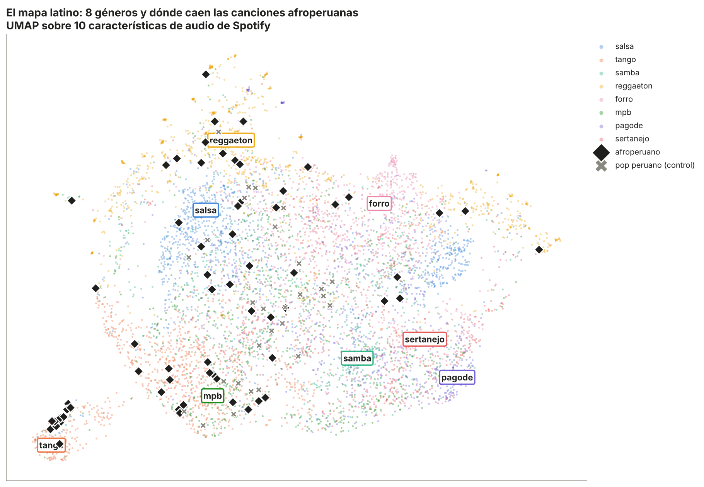
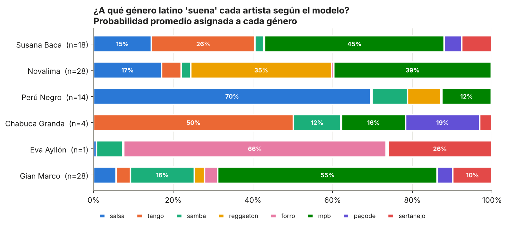
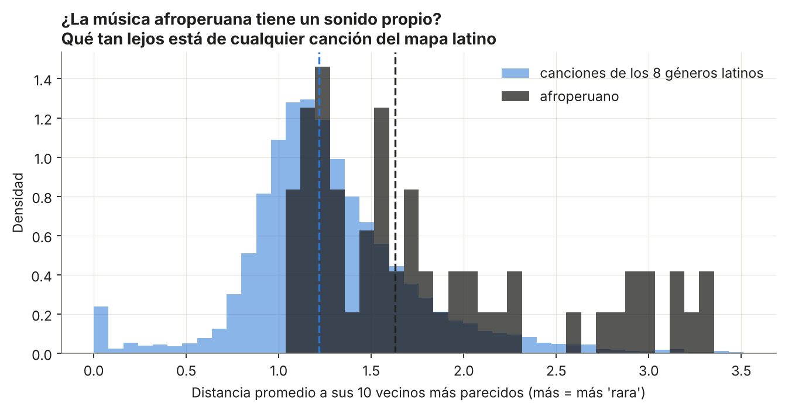
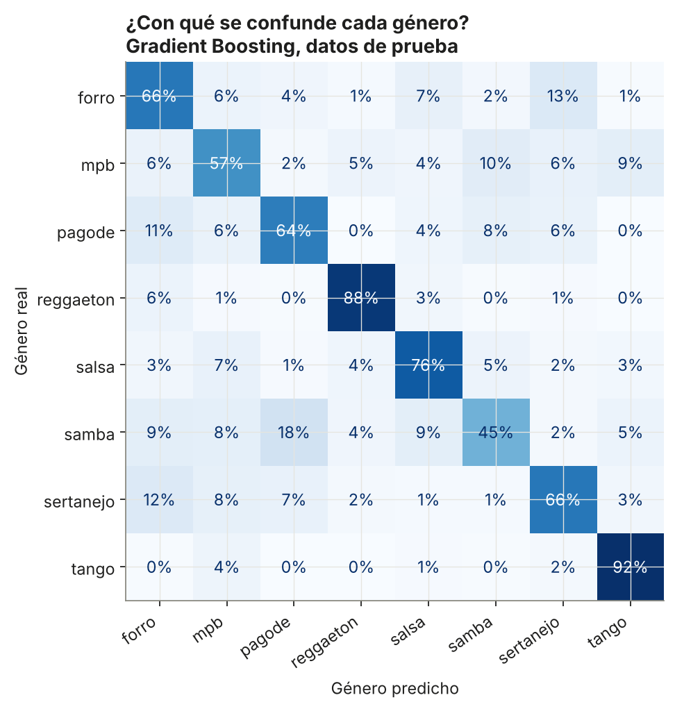
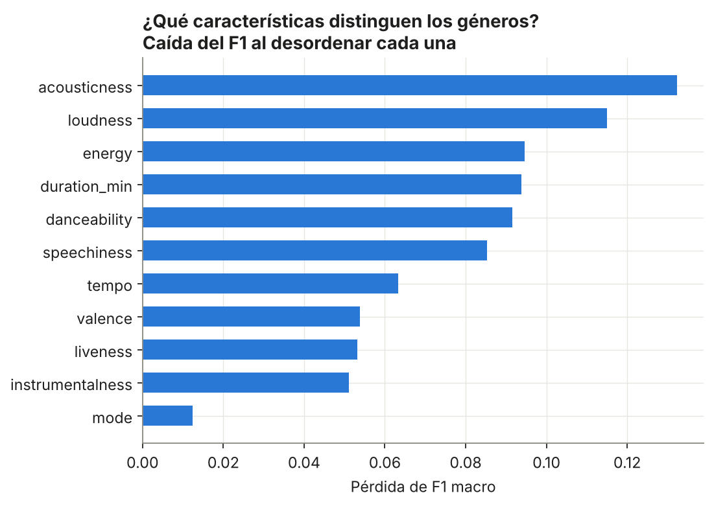
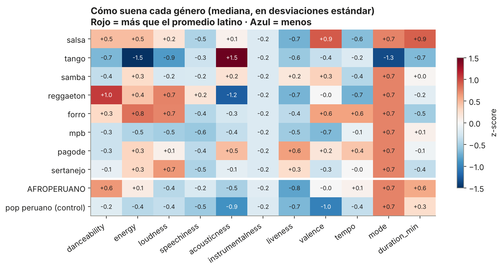

# ¿Dónde cae la música afroperuana en el mapa latino? 🇵🇪🎶



Entrené un modelo para reconocer **8 géneros latinos** (salsa, tango, samba, reggaetón, forró, MPB, pagode y sertanejo) a partir de las características de audio de Spotify. Después le hice escuchar algo que **nunca vio en el entrenamiento**: música afroperuana de Susana Baca, Perú Negro, Novalima, Chabuca Granda y Eva Ayllón.

La pregunta: **¿la música afroperuana suena como algún género latino conocido o tiene un sonido propio?**

## Hallazgos principales

1. **No hay un solo "sonido afroperuano": cada artista cae en un vecindario distinto.**
   - **Perú Negro → salsa (70 %).** El festejo y el landó de percusión (cajón, quijada) comparten la energía bailable y la estructura rítmica de la salsa.
   - **Chabuca Granda → tango (50 %).** Tiene sentido musical: el vals criollo y el tango son primos, con guitarra o piano, mucha acústica y poca energía.
   - **Susana Baca → MPB (45 %) y tango (26 %).** Voz íntima y arreglos acústicos, igual que la música popular brasileña.
   - **Novalima → reggaetón (35 %) y MPB (39 %).** La mitad de sus canciones son remixes electrónicos: el modelo "escucha" la producción y no la raíz afroperuana.

2. **La música afroperuana es más "rara" que el promedio latino.** La distancia mediana a sus 10 canciones latinas más parecidas es **1,63**, frente a **1,22** de una canción latina típica. El **52 %** de las canciones afroperuanas es más atípica que el 80 % de las canciones de referencia.

3. **El grupo de control lo confirma.** El pop peruano (Gian Marco) tiene una rareza de **1,22**, exactamente igual al promedio latino. Es decir, lo atípico no es "ser peruano" ni un sesgo del dataset: es algo específico del sonido afroperuano.




## El modelo

| Modelo | F1 macro (CV 5 folds) | Accuracy (test) | F1 macro (test) |
|---|---|---|---|
| **Gradient Boosting** | **0,663 ± 0,012** | **0,714** | **0,694** |
| Random Forest | 0,655 ± 0,019 | 0,704 | 0,681 |
| Regresión logística (baseline) | 0,563 ± 0,012 | 0,593 | 0,559 |

Un 71 % de accuracy entre 8 géneros (el azar es 12,5 %) está bien considerando que solo usa 11 números por canción, sin audio ni letra. Tango y reggaetón son casi perfectos (F1 de 0,88). Samba, pagode y MPB se confunden entre sí, y eso es esperable: son géneros brasileños emparentados.





## Metodología

1. **Referencia:** 8 géneros del *Spotify Tracks Dataset* (unas 1 000 canciones por género). Se descartan las canciones etiquetadas con más de un género.
2. **Set peruano:** artistas buscados en el dataset de 1,2 M canciones por **coincidencia exacta de nombre**, con verificación manual de los álbumes.
3. **Modelo:** comparación de tres clasificadores con validación cruzada estratificada. Se elige el mejor por F1 macro.
4. **Mapa:** UMAP ajustado **solo con la referencia**. Las canciones peruanas se proyectan después, sin influir en el mapa.
5. **Rareza:** distancia promedio a los 10 vecinos más cercanos en el espacio estandarizado, comparada con la de las propias canciones de referencia.
6. **Doble chequeo:** la predicción del modelo coincide con el género mayoritario de los vecinos más cercanos en el 69 % de las canciones afroperuanas.

## Limpieza de datos: el caso de las dos Lucha Reyes ⚠️

La búsqueda inicial encontró 45 canciones de "Lucha Reyes". Al revisar los álbumes (*Grandes Éxitos de la Música Ranchera*, *Corridos Mexicanos*…) resultó ser **Lucha Reyes, la cantante mexicana de rancheras**, y no la gran intérprete criolla peruana. Si se hubieran incluido, habrían dominado el set afroperuano y llevado a conclusiones falsas. **Por eso se eliminaron.** Lección: buscar por nombre de artista no basta, hay que verificar.

## Limitaciones

- **Muestra pequeña:** 65 canciones afroperuanas (Eva Ayllón tiene 1 y Chabuca Granda 4, así que sus resultados son anecdóticos).
- **No hay cumbia ni chicha** en estos datasets: Grupo 5, Los Mirlos y Juaneco no aparecen. Este proyecto habla de lo afroperuano/criollo, no de toda la música peruana.
- **Novalima** está sesgado por los remixes (la mitad de sus canciones).
- Las características de Spotify son descriptores de alto nivel calculados por un algoritmo cerrado. No captan ritmos específicos como el **cajón**, que es justo lo que define lo afroperuano.

## Siguientes pasos

- Usar audio real (espectrogramas y embeddings de modelos preentrenados) para captar el patrón rítmico del festejo y el landó.
- Añadir cumbia peruana y chicha con otra fuente de datos.
- Hacer una demo interactiva para explorar el mapa canción por canción.

## Cómo reproducirlo

```bash
pip install -r requirements.txt
# descarga los datos según data/README.md
./run_all.sh
```

```
├── data/            # instrucciones de descarga (CSV no incluidos)
├── src/
│   ├── config.py         # géneros, artistas, features, paleta
│   ├── prepare_data.py   # arma set de referencia y set peruano
│   ├── train.py          # compara modelos, matriz de confusión, importancia
│   └── peru_analysis.py  # mapa UMAP, probabilidades, rareza
├── figures/         # gráficas generadas
└── results/         # métricas y detalle por canción
```
